<picture>
  <source media="(prefers-color-scheme: dark)" srcset="./assets/header-dark.svg">
  
</picture>

---

## 📊 GitHub Stats

  <picture>
    <source media="(prefers-color-scheme: dark)" srcset="./assets/stats-dark.svg">
    
  </picture>
  <picture>
    <source media="(prefers-color-scheme: dark)" srcset="./assets/langs-dark.svg">
    
  </picture>

## ✍️ Latest Posts on [kakkky.dev](https://kakkky.dev)

<table>
<tr><th align="left">Title</th><th align="left">Published</th></tr>
<!-- BLOG-POST-LIST:START --><tr><td><a href="https://kakkky.dev/articles/go-structured-concurrency">Goで表現する構造的並行処理</a></td><td>2026-10-19</td></tr>
<tr><td><a href="https://kakkky.dev/articles/k8s-networking-linux">Kubernetesネットワークの仕組みを覗いてみたらそこはLinuxの世界だった</a></td><td>2026-04-29</td></tr>
<tr><td><a href="https://kakkky.dev/series/eks-hands-on">理解して構築してデプロイするまでやるインフラハンズオン</a></td><td>2026-04-26</td></tr>
<tr><td><a href="https://kakkky.dev/articles/go-lossless-compression">なんとなく聞き流しがちな「圧縮」をGoの実装から理解する（可逆圧縮編）</a></td><td>2025-10-26</td></tr>
<tr><td><a href="https://kakkky.dev/articles/go-testing-synctest">testing/synctestはGoランタイムの世界を改変していた</a></td><td>2025-10-04</td></tr>
<!-- BLOG-POST-LIST:END -->
</table>

➡️ [More posts](https://kakkky.dev/feed)

## 🧰 Tech Stack

  

